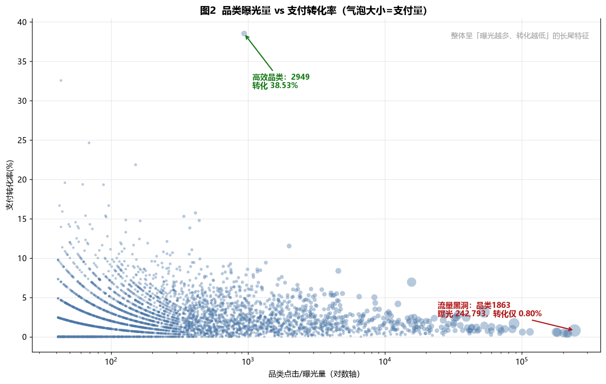
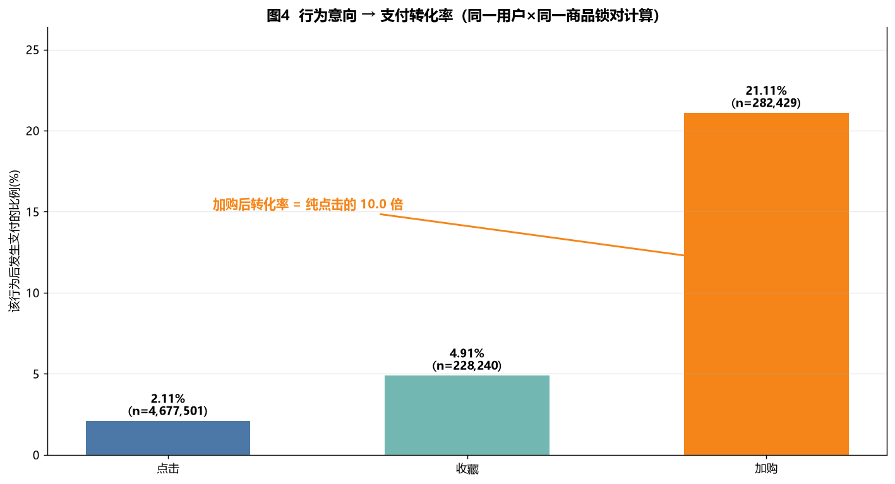
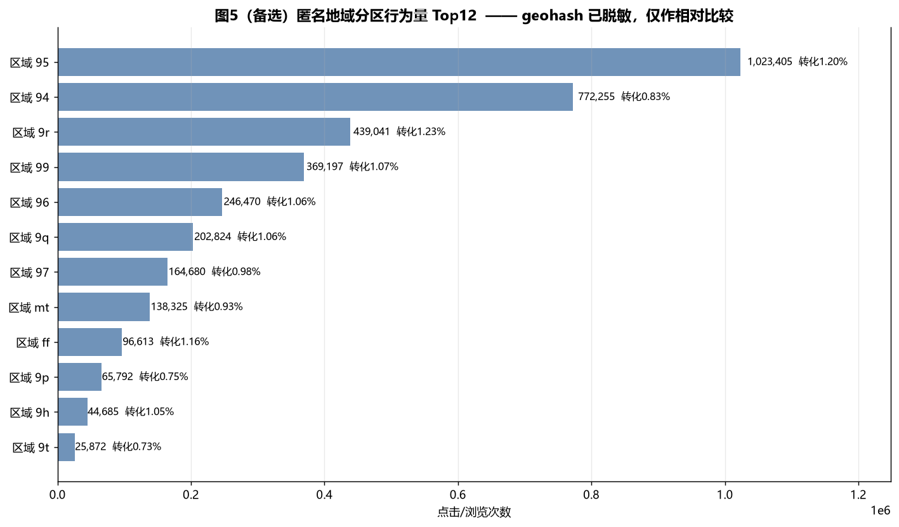

# 步骤 4：数据分析与可视化设计

> 项目：电商用户行为数据分析（淘宝移动端 2014-11-18 ~ 12-18，清洗后 816.4 万条行为记录 / 10,000 名用户 / 31 天）
> 本文档对应作品集「可视化」章节，包含：4 张图的字段设计、可运行的 matplotlib 代码、4 条落地业务结论。
> 全部图表由 `03_visualize.py` 生成，数据源为 `output/eda/` 下的聚合结果。

---

## 一、4 张图的整体设计

| 图号 | 图类型 | X 轴 | Y 轴 | 对应业务问题 | 一句话业务意义 |
|---|---|---|---|---|---|
| 图1 | 双轴折线 + 双轴柱线组合 | 日期 / 小时(0–23) | 行为次数 | 消费时间规律 | 找出「什么时候人多、什么时候买得多」，指导投放时段 |
| 图2 | 散点图（气泡大小=支付量） | 品类曝光量（对数轴） | 支付转化率(%) | 品类差异 | 识别「吃流量不产出」的流量黑洞与高转化品类 |
| 图3 | 洛伦兹 / 帕累托曲线 | 累计用户占比(%) | 累计购买量占比(%) | 复购与高价值用户 | 检验购买是否集中在少数用户，决定用户分层策略 |
| 图4 | 柱状图（转化率） | 行为意向阶段 | 该行为后支付比例(%) | 转化效率（替代地域题） | 证明「加购」是最强购买信号，指导精准召回 |

> **关于第 4 个业务问题的调整**：原定「地域消费力」，但数据集 `user_geohash` 已被**脱敏**（标准算法反解坐标落在北美，无法还原真实城市），画中国地图会是错的。因此主图把第 4 张换成「行为意向→支付转化」，地域分析降级为**备选图 5**（只做匿名分区相对比较，不标城市）。

---

## 二、图表与业务解读

### 图1：用户消费时间规律


**怎么看：** 上图 31 天日趋势用双轴（左轴点击、右轴支付），避免支付量被点击量压成一条平线；下图 24 小时分布同样双轴。

**关键读数：**
- **双十二（12-12）**：点击 430,610（日常 1.83 倍），支付 14,321（日常 **4.46 倍**）。
  → 大促的本质是**「把已有的购物车清空」**，不是「让大家看得更多」。所以大促前要把商品**提前装进购物车/收藏**。
- **黄金四小时 20:00–23:00**：贡献全天点击 **33.64%**；支付峰值在 **21 点**（8,230 次）。
  → 晚间是流量主战场，推送/直播/限时活动应压在这个时段。

### 图2：品类曝光–转化效率（流量黑洞）



**怎么看：** 横轴是曝光量（对数轴，避免长尾挤成一团），纵轴是支付转化率，气泡大小=支付量。越靠右下=吃流量不产出，越靠左上=曝光少但很能卖。

**关键读数：**
- **流量黑洞：品类 1863** —— 曝光 242,793 次（全站头部），转化仅 **0.80%**。
- **小众高效：品类 2949** —— 曝光 937 次，支付 361 次，转化 **38.53%**（注意：曝光体量小，需扩量验证，不能直接当结论）。
- 整体呈「曝光越多、转化越低」的**长尾倒挂**：头部大品类靠流量堆量，真正高效的是中小品类。

### 图3：用户购买量集中度（检验 80/20）


**怎么看：** 把用户按购买件次从高到低排序，横轴是累计用户占比，纵轴是累计购买量占比；对角虚线是「人人等量购买」的绝对平均线。曲线越鼓=越集中。

**关键读数：**
- 前 **10%** 用户贡献 **36.8%** 购买量
- 前 **20%** 用户贡献 **54.8%** 购买量
- 前 **50%** 用户贡献 **84.1%** 购买量
- **结论：经典的「80/20 法则」在这份数据上不成立**（前 20% 只到 54.8%）。购买确实集中，但集中度没有传说中那么极端。

> 这一点比硬套帕累托更有说服力：我在作品集里明确写出「检验了 80/20，结论是不成立」，体现的是**验证假设**而不是**套模板**。

### 图4：行为意向 → 支付转化（加购是最强信号）



**怎么看：** 按「同一用户 × 同一商品」锁对，看在发生过某行为（点击/收藏/加购）的用户-商品对里，最终有多少发生了支付。

**关键读数：**
- 点击后支付率 **2.11%**（n=4,677,501）
- 收藏后支付率 **4.91%**（n=228,240）
- 加购后支付率 **21.11%**（n=282,429）
- **加购转化率是纯点击的 10.02 倍** → 加购是意图最强的购买信号。

### 图5（备选）：匿名地域分区行为量



**说明：** geohash 已脱敏，只能显示「区域 95 / 94 / 9r…」这类匿名前缀，**不能标城市名、不能画地图**。仅用于「区域间相对比较」：区域 95 行为量最高（102 万次，转化 1.20%），区域 94 次之（77 万次，转化 0.83%）。

---

## 三、matplotlib 绘图代码（中文设置 + 注释）

### 3.1 全局中文设置（Windows）

```python
import matplotlib
matplotlib.use("Agg")          # 无界面环境（服务器/脚本）必须，否则会报错
import matplotlib.pyplot as plt
from matplotlib import font_manager

# 中文字体：Windows 优先「微软雅黑」，找不到就退回黑体
CAND = ["Microsoft YaHei", "SimHei", "PingFang SC", "Arial Unicode MS"]
AVAIL = {f.name for f in font_manager.fontManager.ttflist}
CN = next((c for c in CAND if c in AVAIL), None)
if CN:
    plt.rcParams["font.family"] = CN
plt.rcParams["axes.unicode_minus"] = False   # 关键：否则负号显示成方块
plt.rcParams["figure.dpi"] = 130             # 输出清晰度
plt.rcParams["savefig.bbox"] = "tight"       # 保存时自动裁掉多余白边
```

### 3.2 图1：双轴折线 + 双轴柱线

```python
import pandas as pd, matplotlib.dates as mdates

daily = pd.read_csv("output/eda/03_daily_trend.csv", parse_dates=["date"])
hour = pd.read_csv("output/eda/04_hour_distribution.csv")

fig, (ax1, ax2) = plt.subplots(2, 1, figsize=(11, 9))

# —— 日趋势：左轴点击、右轴支付（twinx 解决量级差 30 倍的问题）——
ax1.plot(daily["date"], daily["pv"], color="#4C78A8", label="点击/浏览（左轴）")
ax1.set_ylabel("点击/浏览次数", color="#4C78A8")
ax1r = ax1.twinx()
ax1r.plot(daily["date"], daily["buy"], color="#E45756", lw=2.2, label="支付（右轴）")
ax1r.set_ylabel("支付次数", color="#E45756")

# 标注双十二：倍数用「不含双十二的日常均值」动态算，避免手写错数
d1212 = pd.Timestamp("2014-12-12")
base = daily[daily["date"] != d1212]
buy_r = daily.loc[daily["date"] == d1212, "buy"].iloc[0] / base["buy"].mean()
ax1r.axvline(d1212, color="#F58518", ls="--")
ax1r.annotate(f"双十二 支付约日常 {buy_r:.1f} 倍",
              xy=(d1212, daily.loc[daily["date"] == d1212, "buy"].iloc[0]),
              xytext=(d1212 - pd.Timedelta(days=13), 8000),
              color="#F58518", arrowprops=dict(arrowstyle="->", color="#F58518"))

# 日期刻度：每 3 天一个，避免标签重叠
ax1.xaxis.set_major_locator(mdates.DayLocator(interval=3))
ax1.xaxis.set_major_formatter(mdates.DateFormatter("%m-%d"))

# —— 24 小时：柱=点击，右轴线=支付 ——
ax2.bar(hour["hour"], hour["pv"], color="#4C78A8", alpha=0.85)
ax2r = ax2.twinx()
ax2r.plot(hour["hour"], hour["buy"], color="#E45756", marker="o", ms=4)
ax2.axvspan(19.5, 23.5, color="#F58518", alpha=0.12)   # 高亮黄金四小时
ax2.set_xticks(range(0, 24, 2))
```

### 3.3 图2：曝光–转化散点

```python
cat = pd.read_csv("output/eda/06_category_stats.csv")
cat2 = cat[cat["pv"] >= cat["pv"].quantile(0.5)]   # 去掉极长尾，否则点全挤在原点

fig, ax = plt.subplots(figsize=(11, 7))
ax.scatter(cat2["pv"], cat2["buy_rate"] * 100,
           s=cat2["buy"].clip(upper=3000) / 8 + 10,   # 气泡大小=支付量（截顶防个别点过大）
           color="#4C78A8", alpha=0.4, edgecolor="none")
ax.set_xscale("log")    # 曝光量跨 4 个数量级，必须对数轴
ax.set_xlabel("品类点击/曝光量（对数轴）")
ax.set_ylabel("支付转化率(%)")

hole = cat2.sort_values("pv", ascending=False).iloc[0]   # 流量黑洞=曝光最高
ax.annotate(f"流量黑洞 {int(hole['item_category'])}：转化 {hole['buy_rate']*100:.2f}%",
            xy=(hole["pv"], hole["buy_rate"] * 100), xytext=(hole["pv"] * 0.1, 3),
            color="#B01818", arrowprops=dict(arrowstyle="->", color="#B01818"))
```

### 3.4 图3：洛伦兹 / 帕累托曲线

```python
import numpy as np

u = pd.read_csv("output/eda/08b_user_profile.csv")
s = np.sort(u["records"].values)[::-1]              # 按购买件次降序
cum_u = np.arange(1, len(s) + 1) / len(s) * 100      # 累计用户占比
cum_p = np.cumsum(s) / s.sum() * 100                 # 累计购买量占比

fig, ax = plt.subplots(figsize=(11, 6.5))
ax.plot([0, 100], [0, 100], ls="--", color="#999999", label="绝对平均线")
ax.plot(cum_u, cum_p, color="#E45756", lw=2.4, label="实际累计购买量占比")
ax.fill_between(cum_u, cum_p, cum_u, color="#E45756", alpha=0.08)  # 填充「集中度」面积
ax.axhline(80, ls=":", color="#999999")            # 80% 参考线，直观看出 80/20 是否成立
ax.set_xlabel("累计用户占比(%)")
ax.set_ylabel("累计购买量占比(%)")
```

### 3.5 图4：行为意向转化柱状图

```python
f = pd.read_csv("output/eda/10_pair_funnel.csv")
stages = ["点击", "收藏", "加购"]
rates = f.set_index("stage").loc[stages, "conv_rate"] * 100

fig, ax = plt.subplots(figsize=(11, 6))
bars = ax.bar(stages, rates, color=["#4C78A8", "#72B7B2", "#F58518"], width=0.55)
for b, r in zip(bars, rates):
    ax.text(b.get_x() + b.get_width() / 2, r + 0.35, f"{r:.2f}%", ha="center")
ax.set_ylabel("该行为后发生支付的比例(%)")
```

---

## 四、4 条落地业务结论（面向运营/分析岗，可直接写进作品集）

**结论 1｜预算跟着「夜间 + 大促转化」走，不要跟着「大促流量」走。**
20:00–23:00 贡献全天 33.64% 的点击，是流量主战场，投放/直播/推送应压在这个时段；双十二点击只有日常 1.83 倍，但支付是 **4.46 倍**——说明大促真正放大的是「已种草用户的成交」，不是「新流量」。所以日常就该用加购/收藏把商品预装进购物车，大促只需临门一脚。

**结论 2｜把首页/推荐位流量从「黑洞品类」挪向「高效品类」。**
品类 1863 吃掉 24.3 万次曝光只换来 0.80% 转化，是典型流量黑洞；而品类 2949 转化高达 38.53%（曝光 937 次，样本偏小，需扩量验证）。运营动作：对高曝光低转化的头部品类做「详情页/价格/评价」诊断，同时给小样本高转化品类加曝光做 A/B 测试，把流量从「堆量」转向「提效」。

**结论 3｜用户分层做「腰部」，不要只盯头部。**
购买集中度确实存在，但**不是 80/20**：前 10% 用户只贡献 36.8%，前 50% 才 84.1%。这意味着「只服务头部」会漏掉一大片可提升的中腰部。建议：Top 10% 做会员/专属权益保留存；中腰部（10%–50%）用复购券、品类连带推荐提频——这部分人数量大、边际提升空间最大。

**结论 4｜「加购未支付」是最高优先级召回人群。**
加购后支付率 21.11%，是纯点击（2.11%）的 **10 倍**；收藏（4.91%）居中。运营动作：把「加购未支付」单独圈人，做购物车降价提醒 / 限时券 / 库存告急提示，ROI 远高于全量撒券。另外同品类复购率 57.06% 远高于同商品复购 20.09%，说明该推「品类连带」（买 A 再推同类 B），而不是「再买上次那款」。

---

## 五、面试怎么讲这 4 张图（每图一句话）

- **图1**：「我用双轴解决点击和支付量级差 30 倍的问题，发现大促支付放大 4.46 倍而点击只 1.83 倍，说明大促是收割不是拉新。」
- **图2**：「品类曝光和转化严重背离，头部品类吃 24 万曝光只转化 0.8%，我用对数轴才看清长尾倒挂。」
- **图3**：「我没有直接说帕累托，而是先检验 80/20——结果前 20% 只贡献 54.8%，不成立，所以策略不能只押头部。」
- **图4**：「按同用户同商品锁对算转化，加购后 21% 会买，是纯点击的 10 倍，这是最值钱的一个信号。」

---

## 六、产出文件清单

| 文件 | 说明 |
|---|---|
| `03_visualize.py` | 可视化脚本（4 张主图 + 1 张备选地域图，中文设置齐全） |
| `charts/01_daily_hourly_trend.png` | 图1 消费时间规律 |
| `charts/02_category_efficiency.png` | 图2 品类曝光–转化 |
| `charts/03_user_purchase_pareto.png` | 图3 购买集中度曲线 |
| `charts/04_behavior_intent_funnel.png` | 图4 行为意向转化 |
| `charts/05_geo_region_bonus.png` | 图5 备选匿名地域图 |

---

## 七、局限与说明（写进作品集体现严谨）

1. **地域已脱敏**：geohash 不可反解为真实城市，主图不含地图，图 5 仅匿名分区相对比较。
2. **品类 2949 样本小**（曝光 937），高转化需扩量验证，不能直接下结论。
3. **数据本身是 1 万用户采样集**，所有「占比类」指标不能外推为平台整体转化率。
4. **无订单号**，一条支付记录=支付 1 件商品，复购按「同用户同商品」口径计算（20.09%）。
