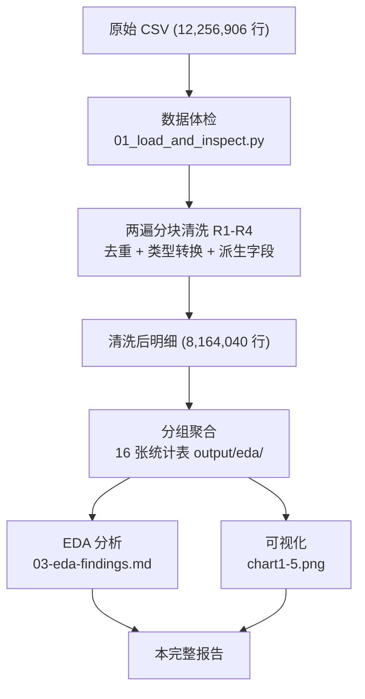
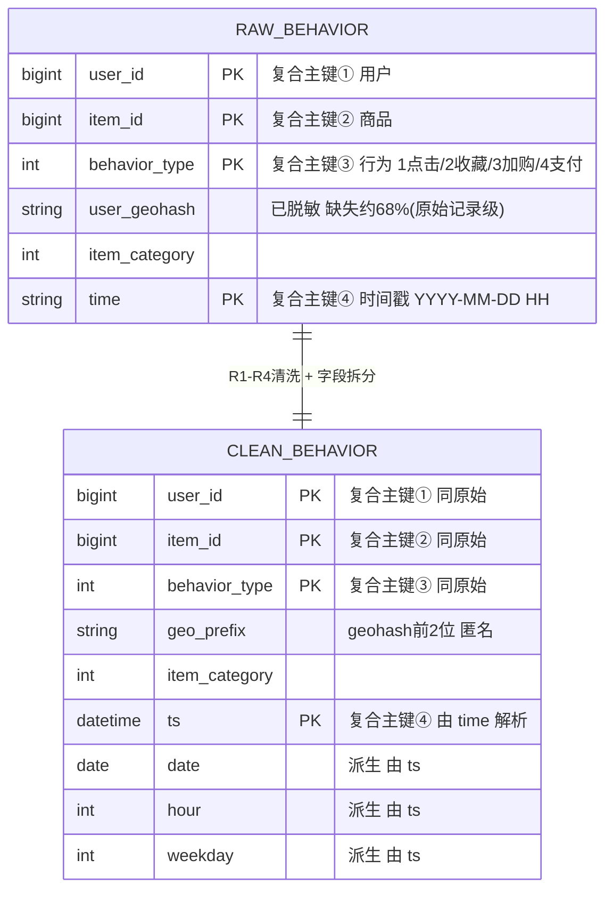
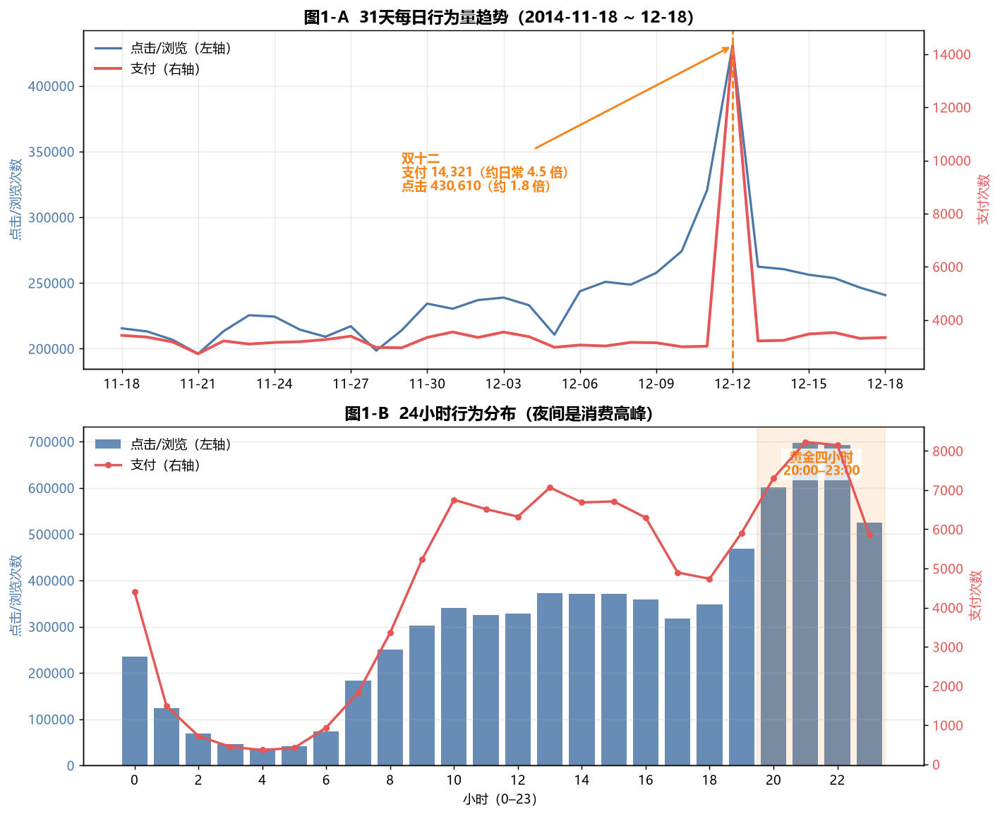
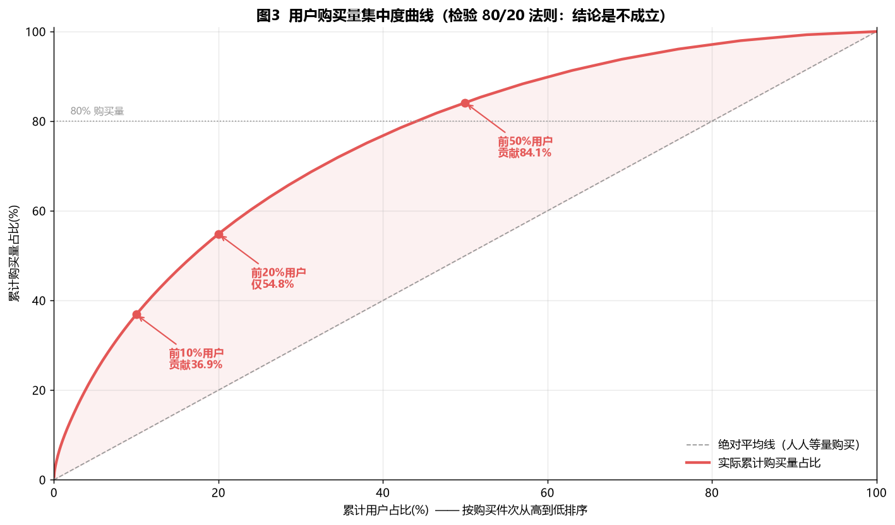

# 电商用户行为数据分析 · 求职作品集项目报告

> 身份：专科大数据技术专业大三学生 · 求职意向：数据分析助理
> 项目类型：基于公开脱敏数据集的行为层数据分析（非爬虫、可复现）
> 配套文件：`01-project-initiation.md`（立项）· `02-data-collection-plan.md`（采集）· `03-eda-findings.md`（EDA）· `04-visualization.md`（可视化）· 本文件（完整报告）

---

## ⚡ 30 秒速览

**一句话定位**：基于天池公开数据集（淘宝移动端 1225 万行行为日志、1 万用户、31 天），回答"用户什么时候买、什么品类好卖、谁是高价值用户、转化路径哪步最强"4 个业务问题，产出 4 条可直接落地的运营建议。

**四条核心结论**：

1. **大促放大的是成交，不是流量**——双十二支付为日常 **4.46 倍**，点击仅 1.83 倍；夜间 20–23 点贡献全天点击 **33.6%**
2. **品类效率差 10 倍**——黑洞品类 1863 吃 24.3 万曝光只转化 **0.80%**，高效品类 6717 转化 **8.37%**
3. **80/20 不成立**——前 20% 用户只贡献 **54.8%** 购买量，中腰部才是最大提升空间
4. **"加购未支付"是最强召回信号**——加购后支付率 **21.11%**，是纯点击的 **10 倍**

**边界（主动声明）**：数据集无价格字段 → 属"行为层"分析而非"经营层"（算不了 GMV/客单价）；未做 RFM 分群（见 6.2/6.3）。

代表图：双轴时间趋势（4.2 节）与意向漏斗（4.5 节）。

## 目录

- [1. 项目概述](#1-项目概述)（业务问题 · 技术链路 · 流程图）
- [2. 数据源与采集方案](#2-数据源与采集方案)
- [3. 数据预处理与清洗](#3-数据预处理与清洗)（R1–R4 规则 · ER 图）
- [4. 探索性数据分析](#4-探索性数据分析eda)（Q1 时间 · Q2 品类 · Q3 用户 · Q4 转化 · 地域备用）
- [5. 业务结论与项目价值](#5-业务结论与项目价值)
- [6. 总结、局限性与优化方向](#6-项目总结局限性与后续可优化方向)（含文件清单与复现步骤）

---

## 1. 项目概述

### 1.1 项目背景与业务目标

电商平台的每一次浏览、收藏、加购、支付，都沉淀为**用户行为日志**。这些数据本身不直接等于经营结论，但能回答运营最关心的一类问题：**用户在什么时候、对什么品类、以何种路径完成购买，以及谁是真正有价值的用户**。

本项目选取阿里云天池公开数据集「阿里移动推荐算法数据集」（淘宝手机端 2014 年 31 天行为日志），以一名**数据分析助理**的视角，完成从数据采集、清洗、EDA 到结论输出的完整链路，产出可直接嵌入简历与作品集网站的分析报告。

**核心目标**：用数据回答 4 个业务问题（见 1.2），并为运营动作提供可落地的建议，而非堆砌图表。

### 1.2 四个业务问题

| 编号 | 业务问题 | 分析落脚点 |
|---|---|---|
| Q1 | 用户**什么时候**购买意愿最强？ | 日趋势（大促）、小时分布、周末对比 |
| Q2 | **什么品类**更容易成交、什么品类在浪费流量？ | 品类曝光量 × 转化率散点 |
| Q3 | **谁是高价值用户**？购买量是否高度集中？ | 购买量帕累托、购买件数分群 |
| Q4 | 用户从"看到"到"买下"的**转化路径**哪一步最强？ | 点击/收藏/加购 → 支付 的意向漏斗 |

> 说明：原方案的第 4 个业务问题为「地域消费力」，但因数据集 `user_geohash` 已脱敏（无法反解真实城市坐标），本报告中该问题降级为「匿名区域比较」备用分析（见 4.6），主分析聚焦 Q1–Q4。

### 1.3 技术链路

```
数据采集 → 数据体检 → 数据清洗(去重/缺失/异常/类型转换) → EDA(分组聚合) → 可视化 → 业务结论
```

| 环节 | 工具 | 交付物 |
|---|---|---|
| 采集 / 体检 | Python · pandas | `01_load_and_inspect.py` |
| 清洗 + EDA | Python · pandas（分块扫描） | `02_clean_and_eda.py` · `output/eda/` 16 张统计表 |
| 可视化 | matplotlib（中文 · 双轴） | `03_visualize.py` · `output/charts/`（chart1_time_pattern / chart2_category_efficiency / chart3_pareto / chart4_intent_funnel / chart5_geo_bonus，共 5 张静态图）+ `03_visualize_anim.py` · `chart1_time_pattern_anim.gif` 动图 |
| 报告 | Markdown + Mermaid | `05-project-report.md` |

### 1.4 数据处理流程图



---

## 2. 数据源与采集方案

### 2.1 数据集选择

网上有两个同名「淘宝用户行为」数据集，字段差异直接决定能否做地域分析，本项目选定 **A 版**：

| 版本 | 来源 | 量级 | 关键字段 | 地域 |
|---|---|---|---|---|
| **A（选用）** | 阿里云天池 dataset 46 · 阿里移动推荐算法 | ~1225 万行 | `user_id, item_id, behavior_type, user_geohash, item_category, time` | ✅ 有 geohash |
| B | 天池 dataset 649（2017 推荐版） | ~1 亿行 | `userid, itemid, categoryid, type, timestamp` | ❌ 无地域 |

> 选型依据：A 版字段与项目需求完全对齐，且带 `user_geohash` 可支撑地域分析；B 版无地域字段，会直接砍掉第 4 个业务问题。

### 2.2 字段字典

| 字段 | 类型 | 含义 | 取值范围 / 备注 |
|---|---|---|---|
| `user_id` | 长整型 | 用户唯一标识 | 全量仅 10,000 人（抽样数据集） |
| `item_id` | 长整型 | 商品唯一标识 | — |
| `behavior_type` | 整型 | 行为类型 | 1=点击/浏览，2=收藏，3=加购，4=支付 |
| `user_geohash` | 字符串 | 地理位置（脱敏编码） | **缺失严重**：原始数据约 68% 缺失，清洗后仍约 53% 缺失（仅约 47% 的清洗后记录带位置），且已不可反解为真实坐标 |
| `item_category` | 整型 | 商品类目 | 数值编号为平台类目 ID |
| `time` | 字符串 | 行为时间 | 格式 `YYYY-MM-DD HH`，小时级 |

### 2.3 采集方式：公开数据集，而非爬虫

- **下载地址**：阿里云天池 `https://tianchi.aliyun.com/dataset/dataDetail?dataId=46`（支付宝/淘宝扫码登录，无境外验证码障碍）。
- **合规声明**：本项目使用的是**公开脱敏数据集**，**未编写任何爬虫**，不涉及淘宝等平台的 robots 协议与反爬法律风险。代码框架中保留的 `crawler_demo.py` 仅以合法练习站 `books.toscrape.com` 演示 requests+bs4 的通用采集范式，与本项目数据源无关。
- **存储**：解压后的 `tianchi_mobile_recommend_train_user.csv` 直接以 UTF-8 读取，落盘为 `data/` 目录下原始文件与清洗后明细。

### 2.4 为什么不用爬虫

1. 淘宝等电商平台**反爬强、需登录、有法律风险**，且作品集写「爬取淘宝」反而是减分项；
2. 本项目目标是**行为分析**，公开数据集已包含完整的行为日志，质量远高于自采的小样本；
3. 公开数据集**可复现、可审计**，面试官能自行下载核对，可信度更高。

---

## 3. 数据预处理与清洗

### 3.1 数据规模

| 指标 | 数值 |
|---|---|
| 原始行数 | 12,256,906 行 × 6 列 |
| 用户数 | 10,000 人（数据集本身为抽样，非全站） |
| 时间窗口 | 2014-11-18 ~ 2014-12-18（31 天） |
| 原始文件大小 | 约 508 MB |

### 3.2 清洗规则（R1–R4）

清洗不只「删缺失、填异常」的默认套路，而是按本数据特性逐条决策，并写死为可审计的规则：

| 规则 | 针对问题 | 做法 | 结果 |
|---|---|---|---|
| **R1 整行精确去重** | 上游重复写入 | 6 字段完全相同的行仅保留首次出现 | 删除 4,092,866 行（33.39%） |
| **R2 行为值校验** | 非法行为类型 | `behavior_type ∉ {1,2,3,4}` 视为异常丢弃 | 异常 0 行 |
| **R3 时间可解析** | 无法做时间分析 | 时间字段解析失败的行丢弃 | 解析失败 0 行 |
| **R4 地理空值保留** | 空值≠错误值 | 不删不填，地域分析时单独过滤 | 原始数据缺失约 68%（清洗后约 53%），单独处理 |

> 补充清洗：时间字符串 → `datetime`，并派生 `date / hour / weekday`；行为类型 → `int8`；业务层去重（同用户同商品同小时支付视为一次，用于修正复购口径）。

### 3.3 清洗前后对比

- **原始 12,256,906 行 → 清洗后保留 8,164,040 行**（删除完全重复 4,092,866 行，占 33.39%）。
- 关键数据质量发现：**重复率按日分布均匀（28.7%~36.7%）**，且与 `user_geohash` 缺失强相关——原始数据 geohash 覆盖仅 32%，去重后升至 47.23%，说明重复记录高度集中在无地理信息的那批数据上。这一线索本身即是「上游存在无地理字段的重复导出」的有力证据。

### 3.4 实体关系图（ER）



> **关于主键（面试官高频追问点）**：行为流水（event log）**没有单一主键**——同一用户可对同一商品产生「点击、收藏、支付」多条记录，也会对同一商品多次点击。因此唯一确定一行的天然键是**四字段复合键 `(user_id, item_id, behavior_type, time)`**（清洗后为 `ts`）。上图两表均按此标注，原稿把 `user_id` 单列为 PK 是错的，已更正。

---

## 4. 探索性数据分析（EDA）

### 4.1 行为结构总览（清洗后）

| 行为 | 含义 | 次数 | 占比 |
|---|---|---|---|
| 1 | 点击 / 浏览 | 7,479,078 | 91.61% |
| 2 | 收藏 | 240,919 | 2.95% |
| 3 | 加购 | 333,371 | 4.08% |
| 4 | 支付 | 110,672 | 1.36% |

> 结构高度符合电商直觉：绝大多数行为是浏览，支付是漏斗最末端、最稀缺的信号。

### 4.2 消费时间规律（Q1）



- **大促效应**：双十二（12-12）支付 **14,321** 次，是日常均值的 **4.46 倍**；但点击仅 1.83 倍——说明大促放大的是**成交意愿**（清购物车），而非流量本身。
- **黄金时段**：20:00–23:00 占全天点击的 **33.6%**，21–22 点是支付最密集时段，应作为投放与客服排班的重点窗口。
- **周末 vs 工作日**：工作日支付转化率 1.535%，高于周末 1.317%——工作日用户的购买目的性更强。

### 4.3 品类差异（Q2）


- **流量黑洞**：品类 1863 获得 **242,793** 次曝光、19,301 次互动，转化率仅 **0.80%**；品类 13230 曝光 217,639 次，转化 0.38%。二者吞掉大量流量却几乎不产出。
- **高效品类**：品类 6717 仅 4,566 次曝光却转化 **8.37%**；品类 6977 曝光 15,653 次、转化 6.94%，贡献 1,086 笔支付。
- **结论**：曝光量与转化率几乎不相关（效率差达 **10 倍以上**）。运营应把预算从黑洞品类向高效品类倾斜，并复盘黑洞品类的页面/定价问题。

### 4.4 复购与高价值用户（Q3）



> **方法说明（口径必须讲清）**：数据集无订单号，一条支付记录 = 支付 1 件商品。因此「复购」严格定义为**同一用户重复购买同一商品**。三种口径分列如下：

| 复购口径 | 数值 | 解读 |
|---|---|---|
| 同一用户复购**同一商品** | **20.09%** | 最严格口径，本报告主用 |
| 同一用户**跨天**复购同一商品 | 17.87% | 排除同小时拆单干扰 |
| 同一用户同**品类**复购（可换款） | **57.06%** | 远高于同商品 → 用户倾向「在喜欢的品类里换款」，而非反复买同一款 |

- **购买量分布（按件数分群）**：

| 购买件数 | 用户数 | 用户占比 | 购买量占比 | 累计 |
|---|---|---|---|---|
| 1 件 | 769 | 8.65% | 0.72% | 0.72% |
| 2 件 | 715 | 8.05% | 1.34% | 2.06% |
| 3–5 件 | 1,822 | 20.50% | 6.71% | 8.77% |
| 6–10 件 | 2,216 | 24.94% | 16.24% | 25.01% |
| 11–20 件 | 1,953 | 21.98% | 26.72% | 51.73% |
| 20 件以上 | 1,411 | 15.88% | 48.27% | 100% |

- **集中度检验**：前 10% 用户贡献 36.8% 购买量，前 20% 仅 54.8%，前 50% 达 84.1%。**经典「80/20」在本数据不成立**——头部贡献没那么极端，中腰部（6–20 件人群，占 46.9%）才是提升整体 GMV 的最大空间。

### 4.5 转化路径效率（Q4）


采用**用户×商品锁对**口径（同一用户对该商品是否最终支付），避免「全站支付÷全站点击」的口径污染：

| 前置行为 | 用户×商品对数 | 后续支付 | 转化率 |
|---|---|---|---|
| 点击 | 4,677,501 | 98,555 | 2.11% |
| 收藏 | 228,240 | 11,196 | 4.91% |
| 加购 | 282,429 | 59,616 | **21.11%** |

- **加购后的支付率是纯点击的 10.02 倍**——「加购」是购买意图最强的信号。
- **运营优先级**：「加购未支付」人群转化潜力最高，应作为召回（购物车提醒、限时优惠）的第一优先级。

#### 4.5.1 为什么「点击转化率」看起来这么低？（互斥口径拆解）

> **先区分两个容易混淆的"21%"**：主表的 **21.11%** 分母是"**加购过**该商品的所有 (用户×商品) 对"；下面的 **21.60%** 分母是"**点过且加购过**的对"（是主表点击组的一个子集）。两者口径不同、都对，细看 4.5.1 分组定义即可。

主表的「点击 → 支付 2.11%」很容易被误读为「点击没用」。实际上点击组内部高度不均——把 467.7 万对「点过」的组合按行为组合**互斥拆分**后（三组合计 4,677,501 对、98,555 笔支付，与主表完全一致）：

| 这一对发生过什么 | 对数 | 占点击组 | 最终购买 | 购买率 |
|---|---|---|---|---|
| 只点击，无收藏无加购（随手浏览） | 4,191,067 | 89.60% | 32,782 | **0.78%** |
| 点击 + 收藏，未加购 | 208,274 | 4.45% | 5,697 | 2.74% |
| 点过 + 加购 | 278,160 | 5.95% | 60,076 | **21.60%** |

> 结论：**「点击转化率低」是约 90% 的随手浏览稀释所致**——真点进去、还加了购物车的用户，购买率 21.6%，是纯浏览的 **27.7 倍**。所以运营该召回的是「加购未支付」人群，而非泛泛提升点击量。这组数字也说明：全站口径的「点击→支付」没有业务意义，必须锁对到 (用户×商品) 维度。

### 4.6 地域消费力（备用·匿名分区）


> 因 `user_geohash` 已脱敏（标准算法反解坐标落于北美，无法对应真实城市），本报告**不绘制中国地图、不标注城市**，仅以 geohash 前 2 位做匿名分区，比较各区域的行为量相对高低。
>
> **这张图该怎么读**：行为量最高的分区是 `95`（108.5 万次，其中支付 12,275 次），其次是 `94`（81.6 万次）。分区间的购买率在 0.8%–1.2% 之间，差异有限——**它只能说明"带位置记录的流量在各匿名分区间分布不均"**，由于编码已脱敏，无法回答"哪个城市买得多"，本节仅作为地域维度的方法论演示，不支撑业务决策。
>
> **数据可用性（务必写清，否则结论站不住）**：geohash 缺失严重——原始数据约 68% 缺失，清洗后仍约 53% 缺失（仅约 **47% 的清洗后记录**带位置）；按**用户**维度看则约 **82%** 的用户至少有一条带位置的行为（无位置的用户反而人均记录更多，与"重复记录集中在无地理信息批次"互为印证）。因此本地域结论仅代表「带地理位置的**记录**」子集，**不可外推全量用户**。

---

## 5. 业务结论与项目价值

### 5.1 四条落地结论

| 结论 | 数据依据 | 对应运营动作 |
|---|---|---|
| **① 预算跟「夜间 + 大促转化」走** | 双十二支付放大 4.46 倍、点击仅 1.83 倍；20–23 点占点击 33.6% | 日常用加购/收藏预装购物车，大促前集中触达；夜间投放加权重 |
| **② 流量从黑洞品类挪向高效品类** | 1863 转化 0.80% vs 6717 转化 8.37%（差 10 倍） | 削减黑洞品类曝光预算，复盘其转化瓶颈；扩量验证高效品类 |
| **③ 分层运营盯中腰部，不唯头部** | 80/20 不成立，前 20% 仅贡献 54.8%，中腰部（6–20 件）占 46.9% | 针对 6–20 件人群做成长型激励，而非只维护头部 |
| **④ 「加购未支付」最高优先召回** | 加购→支付 21.11%，是纯点击的 10.02 倍 | 购物车提醒、限时券优先推给加购未支付用户 |

### 5.2 项目价值（求职视角）

- **业务导向**：始终以「回答业务问题」而非「跑通代码」为终点，结论均可落地。
- **口径严谨**：复购、转化漏斗均显式定义口径，并主动验证「80/20 是否成立」，体现批判性思维（面试高频加分点）。
- **数据素养**：识别出 geohash 脱敏、重复率与缺失强相关等隐藏质量问题，而非机械套流程。
- **工程能力**：用两遍分块扫描在 16GB 内存下精确处理 1225 万行，体现真实大数据处理能力。

---

## 6. 项目总结、局限性与后续可优化方向

### 6.1 总结

本项目完成了一次**端到端、可复现、业务导向**的电商用户行为分析：从 1225 万行原始日志出发，经规则化清洗、分组聚合、可视化，最终提炼出 4 条可直接指导运营动作的结论。全过程使用公开数据集、不依赖爬虫，强调口径透明与数据质量披露。

### 6.2 局限性（诚实披露）

1. **缺少价格字段，无法计算经营指标**：数据集只有行为流水，没有金额，因此 **GMV、客单价（AOV）、毛利率、ROI 等营收类指标完全无法计算**。本项目是「**行为层分析**」而非「**经营层分析**」，这是选择公开数据集换取可复现性所付出的代价，需在面试中主动说明。
2. **未做标准 RFM 用户分群**：当前用户分层仅基于「购买量集中度」，缺少以 R(最近购买)、F(购买频次)、M(购买金额) 为核心的 **RFM 八分群**，也缺少跨期 **cohort 留存矩阵**。因此能指出「谁买得多」，但给不出「这群人该发什么券」的精细化策略。**（已列为后续优化第一项）**
3. **复购口径受限**：受无订单号约束，复购只能定义为「同用户同商品/同品类」，无法计算业务通用的「30 天内再次购买任意商品」复购率。
4. **地域字段脱敏**：`user_geohash` 原始数据缺失约 68%（清洗后仍约 53% 缺失），且不可反解为真实坐标，地域分析只能做匿名分区比较、仅代表带位置记录的子集，无法定位城市级消费力，亦不可外推全量用户。
5. **时间窗口短且为抽样数据集**：仅 31 天、用户固定为 10,000 人，结论反映该窗口内的行为模式，不代表长期趋势或全站真实分布；「88% 用户有支付」等比例不可误读为平台转化率。
6. **单一平台、历史数据**：数据为 2014 年淘宝移动端，与当下电商形态（直播、内容电商）存在代差。

### 6.3 后续可优化方向

| 方向 | 说明 | 价值 |
|---|---|---|
| **补做 RFM 分群** | 用 R=距窗口末天数、F=购买次数、M=购买件数（代理）构建八分群，并给每群配运营动作 | 把「用户分层」从描述升级为策略 |
| **cohort 留存矩阵** | 按首购日分组计算后续周期留存 | 量化用户黏性与流失 |
| **引入价格/订单数据** | 若有带金额的数据，补全 GMV/AOV/ROI | 升级为经营层分析 |
| **品类关联（购物篮）** | 同一用户同订单/同会话的多品类共现 | 支撑连带推荐 |
| **动态可视化上作品集首页** | 已产出 `chart1_time_pattern_anim.gif`，用于演示 | 提升展示观感 |

### 6.4 附：文件清单与复现方式

```
ecommerce-portfolio/
├── 01-project-initiation.md        立项方案
├── 02-data-collection-plan.md      采集方案
├── 03-eda-findings.md             EDA 发现
├── 03b-data-cleaning.md           清洗说明（含代码）
├── 04-visualization.md            可视化说明
├── 05-project-report.md           本报告
├── 01_load_and_inspect.py         体检脚本
├── 02_clean_and_eda.py            清洗+EDA 脚本
├── 03_visualize.py                静态图脚本
├── 03_visualize_anim.py           动图脚本
├── data/                          原始 + 清洗后数据
└── output/
    ├── eda/                       16 张统计表 + EDA_SUMMARY.txt
    └── charts/                    chart1-5.png + 动图 GIF
```

**复现步骤**：

```bash
# 1. 下载天池 dataset 46，解压为 data/tianchi_mobile_recommend_train_user.csv
# 2. 体检
python 01_load_and_inspect.py
# 3. 清洗 + EDA（约 30 秒，落盘 output/eda/ 统计表与 data/clean/ 清洗后明细；磁盘紧张可加 --no-save-clean 跳过明细落盘）
python 02_clean_and_eda.py
# 4. 可视化
python 03_visualize.py
# 5. 动图（可选）
python 03_visualize_anim.py
```

> 运行环境：Python 3.13 · pandas 3.1 · matplotlib 3.11；依赖隔离安装在项目 venv，固定随机种子与采样逻辑以保证可复现。
